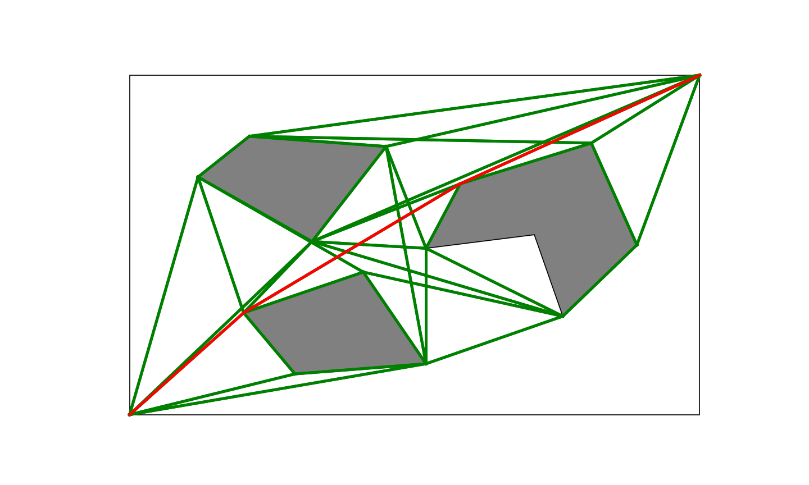

# 🧭 Shortest Path Roadmap (SPR): Robot Path Planning in Python

> A Python implementation of the **Shortest Path Roadmap** algorithm for 2D motion planning. Given a set of polygonal obstacles, the program builds a visibility-style roadmap from the obstacles' reflex vertices and bitangent edges. It then finds the shortest collision-free path between a start and a goal point using **Uniform Cost Search**, and plots the result with Matplotlib.



*The roadmap is drawn in green and the shortest path from (0, 0) to (10, 10) in red. The grey shapes are obstacles.*

---

## ✨ Features

- 📐 **Reflex vertex detection** using orientation (cross-product) tests on polygon vertices
- 🔗 **Bitangent edge construction**: an edge is kept only if it's tangent to the obstacles at both ends and doesn't cross any obstacle
- 🚧 **Collision checking** with segment–segment intersection tests
- 🎯 **Start and goal added** to the roadmap by connecting them to every vertex they can see
- 🔍 **Uniform Cost Search** (Dijkstra-style, using a `heapq` priority queue) for the optimal path
- 📊 **Matplotlib visualization** of the obstacles, the full roadmap and the final path

---

## 🧠 How It Works

The shortest path between two points around polygonal obstacles always bends only at **reflex (convex-outward) vertices** of the obstacles. SPR uses this fact to shrink the search space from the continuous plane to a small graph.

| Step | Function | Description |
|------|----------|-------------|
| 1. Parse | `__main__` | Read the obstacles from the environment file |
| 2. Reflex vertices | `findReflexiveVertices()` | Keep the vertices where three consecutive points turn clockwise |
| 3. Build roadmap | `computeSPRoadmap()` | Connect every pair of reflex vertices whose segment is a **bitangent** (`find_bitangent`) and collision-free (`collision_check`). Edge weights are Euclidean distances |
| 4. Add start and goal | `updateRoadmap()` | Add the start (label `0`) and goal (label `-1`) and link them to each roadmap vertex they can see |
| 5. Search | `uniformCostSearch()` | Pop the lowest-cost node from the priority queue until the goal is reached, then trace back through the parent pointers |
| 6. Output | `__main__` / `visualize.py` | Print the path and its length, or plot them |

**Complexity:** with *n* obstacle vertices, building the roadmap takes O(n³) (n² vertex pairs × n edge checks). The search runs in O(E log V).

---

## 📁 Project Structure

```
Shortest-Path-Roadmap-algorithm-implementation/
├── spr.py          # The SPR algorithm (can also be run on its own, printing text output)
├── visualize.py    # Runs SPR and plots the roadmap and path with Matplotlib
├── env_01.txt      # Sample environment with 3 polygonal obstacles
└── Figure_1.png    # Sample output
```

---

## 🗺️ Environment File Format

Each line is one polygon. Vertices are separated by `;`, and each vertex is written as `x,y`. The workspace is a **10 × 10** square.

```text
2,3;4.1,4.2;5.2,1.5;2.9,1.2
5.2,4.9;5.8,6.8;8.1,8.0;8.9,5;7.6,2.9;7.1,5.3
1.2,7.0;2.1,8.2;4.5,7.9;3.2,5.1
```

---

## 🚀 Getting Started

### Prerequisites
- Python 3.x
- NumPy and Matplotlib

```bash
pip install numpy matplotlib
```


### Run with visualization
```bash
python visualize.py env_01.txt <start_x> <start_y> <goal_x> <goal_y>
```
For example:
```bash
python visualize.py env_01.txt 0 0 10 10
```
> `visualize.py` reads the coordinates as **integers**.

### Run with text output only
```bash
python spr.py env_01.txt 0 0 10 10
```
This prints the obstacles, the reflex vertices, the vertex map, the base and updated roadmaps, and then the final path and its length:
```
Final path:
[0, ..., -1]
Final path length: <distance>
```

---

## 🛣️ Possible Improvements

- [ ] Support decimal start and goal coordinates in `visualize.py`
- [ ] Swap Uniform Cost Search for **A\*** with a Euclidean heuristic
- [ ] Speed up roadmap construction with a rotational sweep (O(n² log n))
- [ ] Inflate the obstacles for a robot with nonzero radius (configuration space)
- [ ] Add more sample environments and unit tests